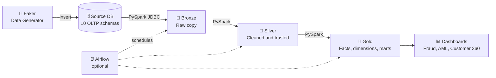

<div align="center">

# 🏦 BankFlow

### End-to-End Banking Data Platform

**PostgreSQL • PySpark • Medallion Architecture • Airflow**


*A production-style banking data platform: a fully relational OLTP database, a synthetic data generator, and a PySpark medallion pipeline (Bronze → Silver → Gold) with fraud and AML analytics.*

</div>

---

## 📖 Table of Contents

- [Overview](#-overview)
- [Architecture](#-architecture)
- [Database Design](#-database-design)
- [Banking Scenarios Covered](#-banking-scenarios-covered)
- [Data Engineering Highlights](#-data-engineering-highlights)
- [Tech Stack](#-tech-stack)
- [Project Structure](#-project-structure)
- [Getting Started](#-getting-started)
- [Roadmap](#-roadmap)
- [Keywords](#-keywords)
- [Author](#-author)

---

## 🎯 Overview

**BankFlow** simulates the data backbone of a Canadian retail bank. It covers the full journey of banking data:

1. 🧪 **Generate** realistic synthetic banking data with Python and Faker
2. 🗄️ **Store** it in a normalized, constraint-rich PostgreSQL source database (OLTP)
3. ⚡ **Process** it with PySpark through Bronze, Silver and Gold layers
4. 📊 **Serve** analytics marts for fraud detection, AML monitoring, customer 360 and loan risk

> 💡 **Why this project?** It demonstrates relational data modeling, data warehousing, distributed ETL, data quality, and compliance-aware design in a single end-to-end build.

---

## 🏗️ Architecture



| Layer | Purpose | Key operations |
|---|---|---|
| 🥉 **Bronze** | Raw, append-only copy of source tables | Ingestion metadata (`_ingested_at`, `_batch_id`), incremental watermark loads |
| 🥈 **Silver** | Cleaned and standardized data | Deduplication, late-arriving data handling, PII masking, SCD Type 2, rejected-record quarantine |
| 🥇 **Gold** | Business-ready analytics | Star schema, fraud and AML detection marts, customer 360, loan risk |

---

## 🗃️ Database Design

The source database is split into **10 schemas** with **86 tables**, **806 columns** and **181 foreign key relationships**, all designed with referential integrity in mind.

| Schema | Domain | Tables |
|---|---|---|
| `ref` | Reference data (currency, product, channel, geography) | 12 |
| `ops` | Branches, ATMs, employees, service tickets | 7 |
| `cust` | Customers, KYC, addresses, risk rating, beneficiaries | 11 |
| `acct` | Accounts, joint holders, balances, fees, overdraft | 9 |
| `txn` | Transactions, double-entry ledger, transfers, bill payments | 11 |
| `card` | Cards, card transactions, statements, disputes, rewards | 9 |
| `loan` | Applications, loans, EMI schedules, delinquency, collateral | 10 |
| `risk` | Login events, fraud rules, alerts, investigation cases | 5 |
| `aml` | AML rules, alerts, large cash reports, STR, watchlists, PEP | 7 |
| `audit` | Audit log, reconciliation, data quality, ETL run logs | 5 |

### 🔑 Design principles

- ✅ Surrogate `bigint` identity keys with enforced foreign keys everywhere
- ✅ `numeric(18,2)` for money, never floating point
- ✅ **Double-entry ledger** where every debit has a matching credit
- ✅ **Monthly range partitioning** on high-volume tables (transactions, ledger, card transactions, daily balances, login events, audit log)
- ✅ **SCD Type 2** history for address, contact, risk rating, segment, interest rate and limits
- ✅ Check constraints for status and type columns
- ✅ PII columns encrypted, card numbers tokenised (full PAN and CVV are never stored)

---

## 🧩 Banking Scenarios Covered

<details>
<summary><b>👤 Customer and KYC</b></summary>

- Individual and business onboarding
- KYC document verification (pending, approved, rejected)
- Address, phone and name changes with SCD2 history
- Customer segmentation, risk rating, dormant and closed customers
- Joint holders and nominees

</details>

<details>
<summary><b>🏦 Accounts</b></summary>

- Chequing, savings, TFSA, RRSP and business accounts
- Status changes (active, frozen, dormant, closed)
- Overdraft limits and usage, interest, fees and penalties
- Monthly statements

</details>

<details>
<summary><b>💸 Transactions and Ledger</b></summary>

- Deposits, withdrawals, internal transfers, Interac e-Transfer and wires
- Bill payments and pre-authorized debits
- Pending vs posted, failed and reversed transactions
- Double-entry ledger, FX conversion, daily balance snapshots

</details>

<details>
<summary><b>💳 Cards</b></summary>

- Debit and credit card lifecycle (issue, activate, block, replace)
- POS, online and international transactions
- Credit limits, statements, late fees, interest, disputes and rewards

</details>

<details>
<summary><b>🏠 Loans and Mortgages</b></summary>

- Application and approval workflow, credit checks
- Personal, auto and mortgage loans with EMI schedules
- Missed payments, delinquency buckets, NPA classification
- Prepayment, foreclosure, collateral and guarantors

</details>

<details>
<summary><b>🚨 Fraud Detection</b></summary>

- Unusual amount, velocity checks, impossible travel
- New device or location logins, card testing patterns
- Alerts, investigation cases and false-positive tracking

</details>

<details>
<summary><b>🛡️ AML and Compliance</b></summary>

- Large cash transaction reporting (10,000 CAD and above, FINTRAC)
- Structuring detection, suspicious transaction reports (STR)
- Sanctions and watchlist screening, PEP flagging
- Full audit trail

</details>

---

## ⚙️ Data Engineering Highlights

| Capability | Description |
|---|---|
| 🏅 **Medallion architecture** | Bronze, Silver and Gold layers implemented with PySpark |
| 🔄 **Incremental loading** | Watermark-based loads using an ETL watermark table |
| ♻️ **Idempotent pipelines** | Safe re-runs with source-system IDs and deduplication |
| ⏳ **Late-arriving data** | Handled in the Silver layer |
| 📜 **SCD Type 2** | Full history for customer, account and rate dimensions |
| ✔️ **Data quality checks** | Null, uniqueness, referential integrity and range checks logged to `audit.dq_check_result` |
| ⚖️ **Reconciliation** | Ledger totals reconciled against account balances |
| 🔐 **PII protection** | Encryption, masking and row-level security |
| 🧱 **Partitioning and indexing** | Monthly partitions and targeted indexes for query performance |
| 🔍 **Lineage and audit** | Trigger-based audit log, batch IDs and ETL run logs |

---

## 🧰 Tech Stack

| Category | Tools |
|---|---|
| **Database** | PostgreSQL |
| **Processing** | PySpark (Apache Spark), JDBC |
| **Language** | Python, SQL |
| **Data generation** | Faker, SQLAlchemy / psycopg2 |
| **Orchestration** | Apache Airflow *(optional)* |
| **Containerization** | Docker, Docker Compose |
| **Visualization** | Metabase / Streamlit *(planned)* |

---

## 📁 Project Structure

> 🚧 Planned layout. It will be updated as each part is completed.

```
bankflow/
├── 📂 sql/
│   ├── 01_schemas/          # schema creation
│   ├── 02_tables/           # DDL per schema
│   ├── 03_constraints/      # FKs, checks, deferred constraints
│   ├── 04_indexes/          # indexes and partitions
│   └── 05_triggers/         # audit triggers
├── 📂 data_generator/       # Faker scripts, one module per scenario
├── 📂 spark_jobs/
│   ├── bronze/              # source → bronze
│   ├── silver/              # bronze → silver
│   └── gold/                # silver → gold
├── 📂 airflow/dags/         # orchestration (optional)
├── 📂 docs/
│   ├── erd/                 # ER diagrams
│   └── schema_design.xlsx   # table and column design
├── 🐳 docker-compose.yml
└── 📄 README.md
```

---

## 🚀 Getting Started

> 🚧 Setup instructions will be finalized once the pipeline is complete.

```bash
# 1. Clone the repository
git clone https://github.com/<your-username>/bankflow.git
cd bankflow

# 2. Start PostgreSQL (and Spark) with Docker
docker compose up -d

# 3. Create the source schemas and tables
#    (run the SQL files in /sql in order)

# 4. Generate synthetic data
python data_generator/main.py

# 5. Run the PySpark pipeline
#    source → bronze → silver → gold
```

---

## 🗺️ Roadmap

- [x] Define banking scenarios across 10 domains
- [x] Design source database (86 tables, relationships, keys, constraints)
- [x] Define medallion architecture
- [ ] Draw ER diagrams per schema
- [ ] Write DDL (tables, constraints, indexes, partitions, triggers)
- [ ] Build the Faker data generator (scenario by scenario)
- [ ] Load data and validate (FK checks, ledger reconciliation)
- [ ] PySpark: source → Bronze
- [ ] PySpark: Bronze → Silver
- [ ] PySpark: Silver → Gold (facts, dimensions, marts)
- [ ] Fraud and AML detection marts
- [ ] Dashboards
- [ ] Airflow orchestration
- [ ] Performance benchmarks (indexing and partitioning impact)

---

## 🔖 Keywords

`Data Engineering` `Banking` `Fintech` `PostgreSQL` `PySpark` `Apache Spark` `Medallion Architecture` `Bronze Silver Gold` `ETL` `Data Warehouse` `Data Modeling` `ERD` `Star Schema` `SCD Type 2` `Slowly Changing Dimensions` `Double-Entry Ledger` `Table Partitioning` `Incremental Load` `Idempotent Pipelines` `Data Quality` `Data Reconciliation` `Fraud Detection` `AML` `KYC` `FINTRAC` `Data Governance` `PII Masking` `Audit Trail` `Airflow` `Docker` `Python` `SQL` `Faker` `Synthetic Data`

---

## 👨‍💻 Author

**Muhammad Anas Arshad**
Co-Founder and CEO at Insighterz | Data Engineering and AI

📍 Mississauga, Ontario, Canada
🔗 [LinkedIn]([https://www.linkedin.com/in/your-profile](https://www.linkedin.com/in/anas-arshad-125059197/)) • 🌐 [Website]([https://github.com/your-username](https://id-preview--017c28d6-4a92-4fb0-9c8c-9736540b83bd.lovable.app/about)) 🐙 [Github]([https://github.com/anasarshadcad])

---

<div align="center">

⭐ If you find this project useful, consider giving it a star!

</div>
